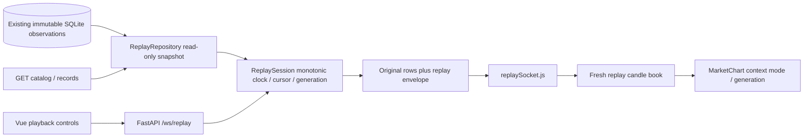

# Component responsibilities and actual data flow

```mermaid
flowchart LR
    Yahoo[Yahoo Finance WebSocket] --> Shared[One yfinance socket / four symbols]
    Shared --> Normalize[Normalize quote / per-symbol freshness]
    Normalize --> Transaction[SQLite transaction: raw + candle revision]
    Timer[Candle completion timer] --> Transaction
    Transaction --> Commit[Post-commit record hook]
    Commit --> Hub[MarketSocketHub]
    Hub --> Q1[Bounded client queue / AAPL]
    Hub --> Q2[Bounded client queue / MSFT]
    Q1 --> WS[FastAPI /ws/market]
    Q2 --> WS
    WS --> Proxy[Vite WebSocket proxy]
    Proxy --> Client[Reusable Vue WebSocket service]
    Client --> Book[Revision-aware candle book]
    History[REST saved candle history] --> Book
    Book --> Chart[Lightweight Charts: price and volume panes]
    Client --> UI[Dashboard: price / age / connection states]
    Chart --> UI
    UI -->|subscribe symbol + request_id| WS
    UI -->|GET /api/health| Health[Health route]
```

| Component | Responsibility |
| --- | --- |
| backend/app/main.py | Lifespan startup/shutdown for database, socket hub and market service |
| services/yahoo_stream.py | Pinned yfinance adapter and one upstream subscription set |
| services/normalization.py | Preserve original provider fields, UTC times and fallback observation identity |
| services/market_data.py | Shared transport/reconnects; independent per-symbol repositories and freshness |
| services/candles.py | Deterministic source-time quote OHLC and lineage; no invented volume |
| services/market_repository.py | Atomic persistence, post-commit events, snapshot and REST reads |
| services/database.py / schema.sql | Append-only transactions, revisions, duplicate detection and indexes |
| services/market_socket.py | Versioned envelope, thread-safe fanout scheduling, bounded client queues, status pulses |
| routes/market_socket.py | Origin checking, subscription validation, one sender/receiver per client, shielded cleanup |
| routes/health.py / market.py | Independent health and historical read-only market APIs |
| frontend/src/services/marketSocket.js | Same-origin WebSocket, request generations, reconnect limits and idle watchdog |
| frontend/src/App.vue | Symbol/interval selection, history/live merge, last-known information and distinct connection states |
| frontend/src/components/MarketChart.vue | Reusable candlestick/volume chart, overlays, resize/lifecycle and attribution |
| frontend/src/services/candleBook.js | Stable candle identity, revision ordering and bounded display window |
| frontend/src/services/candleHistory.js | Historical HTTP generations/abort and live merge |
| frontend/src/services/chartRenderer.js | Supported TradingView series updates and sorted historical insertion |
| frontend/vite.config.js | /api HTTP proxy and /ws upgrade proxy |
| backend/scripts/verify_market_socket.py | Explicit network pipeline verification with REST/SQLite record comparison |
| backend/tests and frontend/tests | Offline mocked transport, rollback, isolation, lifecycle and UI tests |

The browser has no Yahoo connection or credentials. Connecting/switching a browser
only changes its backend filter. The finite four-symbol Yahoo subscription is shared
and recreated once per upstream reconnect. Raw and candle rows commit before any
broadcast. Disconnected/slow clients cannot block the market service. Feed failures
continue to be sent as status while the browser socket remains open.

On resubscription the latest committed quote/candle is sent as a labeled snapshot;
this restores last-known values without pretending a new provider observation occurred.
The selected request generation prevents queued old-symbol frames from mixing stocks.

Protocol details, delivery guarantees, limits and close codes are in
[websockets.md](websockets.md). Part4.2 indicators, simulated trading and backtesting are described below. AI/audio,
automatic gap replay and a multi-process message broker remain unimplemented.

The chart receives backend-constructed OHLC, not raw prices reaggregated in Vue.
`/api/market/symbols` now includes active_interval for the initial UI selection.
HTTP history and WebSocket revisions merge into the same book; old selection
responses and lower revisions cannot replace current state. Only explicit reliable
interval volume becomes histogram bars. The current Yahoo quote feed supplies none,
so the aligned pane remains honestly empty. See charting.md for rendering details.

## Independent recorded replay flow

ReplayRepository is responsible for bounds, ordering and as-of baseline; ReplaySession
owns pure timed state; routes/replay.py validates commands and transports each client's
session. Replay does not call the Yahoo adapter, live hub, ingestion or database writes.
A backend with FEED_ENABLED=false supports replay fully from saved observations.

App.vue disposes live history and closes its market socket on entry. Callback epochs,
transport generations and symbol/interval/revision checks isolate replay. Restart/Stop
clear future chart state and reapply the original baseline. Returning to Live creates
fresh history and resubscribes; intermediate live rows remain in SQLite even while
this browser replays. Other browsers/provider capture continue independently.
A lost replay transport ends its in-memory session; explicit reload is required.
See replay.md for message schema and exact state transitions.

## Final pipeline trace and verification boundaries
The final audit's actual Yahoo observation #453 was decoded with its original payload,
normalized with separate source/receipt UTC values, committed, broadcast as a new
non-snapshot market_observation, and displayed in Vue. The independent socket capture
matches the SQLite row exactly; browser source time, receipt time and price match too.
See evidence/final-end-to-end-trace.json. ID numbers refer to that audit's isolated
fresh database, not globally unique IDs across installations.

A browser subscription snapshot is a read of a prior row. verify_market_socket.py now
keeps snapshots separate and only newly broadcast raw observations can prove current
provider receipt. It checks the exact ID using the ingest cursor rather than assuming
that the first 1,000 historical rows contain the observed event. Neither a successful
probe nor a fresh socket establishes exchange real-time entitlement.

Native volume bars were checked using a separate explicitly simulated database. The
actual Yahoo stream still cannot establish interval volume. No browser connects directly
to Yahoo; all chart rows still travel through persisted backend records and APIs/sockets.

Fresh feed status is now explicitly separate from conservative stored provenance:
`real_time_unverified` is a status-only state for fresh unconfirmed streaming observations.
Vue displays Real-time unverified and independently ages it into delayed/stale between
messages. Stored delayed provenance stays visible under its own label, and replay,
simulated data, disconnects and last-known values retain their distinct presentation.

## All supported intervals live — 2026-11-11
The per-symbol persistence transaction now produces 1m/5m/15m revisions from one raw
observation. The existing completion timer checks all three; the existing post-commit
hub broadcasts their interval-tagged rows. Subscription restoration reads a snapshot
for each interval, and the symbols/feed-status API advertises live_intervals. Vue's
selected-interval book filters other candles. No new Yahoo socket, client-side OHLC
construction, schema migration or speculative future module is needed.

## Part 4.2 indicator flow — 2026-11-12
- services/indicators.py: completed-only20/50 calculation, stable crossing slots and
  read-only saved/as-of snapshots; original observations/revisions remain immutable.
- routes/indicators.py: validated config/SMA/signals GETs and arrived-candle POST evaluation.
- frontend services/indicators.js:100ms request coalescing, timeout, stale-response guards,
  independent errors; no local calculation or direct provider connection.
- App.vue/MarketChart.vue/chartRenderer.js: legend/status/toggle, two price-pane LineSeries
  and confirmed directional markers, with existing candlestick/volume/zoom preserved.

Data flow: merged live or arrived replay candle book → POST /api/indicators/evaluate →
pure backend snapshot → latest completed status / SMA lines / marker replacement.
Historical standalone queries read SQLite at one maximum ID. Replay does not use these
current-history GETs, preventing future revision lookahead. Local CORS now allows POST
for this concrete API while retaining the same explicit origins and no credentials.
The indicator API has no execution side effects; separate trading/backtesting services
are described below.

## Manual paper-account flow — 2026-11-12
PaperAccount.vue shares the primary chart workspace (sticky ticket plus full-width ledger)
and owns only account GET refreshes
and explicit user POST actions. It does not subscribe to SMA signals. Account reads/errors
are independent of market sockets, indicators and chart interaction. Retries reuse a
client order identity; replay disables submit/fill controls without resetting the account.

routes/paper.py validates DTOs and delegates to services/paper_account.py. The service
serializes pending validation→fill→cash/position update→terminal status in one SQLite
transaction. app/paper_schema.sql provides additive account/order/fill/position tables,
separate from immutable market observations. Account valuation reads saved provider
quotes only; manual execution uses the explicit requested price and cannot reach a broker.

## Automatic simulated strategy flow — 2026-11-12
main.py wires the repository post-commit callback to broadcast and StrategyService.
The strategy independently reloads persisted rows, validates provenance/completion and
records SMA input IDs, signals and decisions. Subsequent eligible raw quotes execute
through PaperAccount using the same SQLite transaction for fill, balances, scope shares
and decision result. Unique signal/order/fill keys prevent reconnect/restart duplicates.
Routes /api/strategy/status, /config and /fills expose state and explicit controls; clients
cannot submit signals. StrategyPanel polls them independently of WebSocket/replay.
Replay cannot drive execution; actual live arrivals may continue if previously enabled.
See strategy.md for live execution timing and limits, and backtesting.md for the
separate historical runner.

## Historical backtesting components — 2026-11-12
- routes/backtests.py: strict configuration/date/period validation; run/list/result HTTP.
- services/backtests.py: read snapshot, candle validation/dedup, event loop, isolated
  integer-money account, equity/drawdown/trade metrics and immutable result persistence.
- indicators.sma_step: shared SMA/crossing primitive for live views and backtesting.
- paper_account.allocation_quantity: shared exact20% whole-share sizing for both engines.
- app/backtest_schema.sql: additive version1 and immutable backtest_runs result records.
- BacktestPanel.vue: explicit requests and independently labeled historical summary,
  SVG equity curve, fills vs completed trades, loading/error/insufficient-data handling.

Flow: stored observations → first completed candle selection → timestamped open/close
availability events → shared SMA → pending decision → next eligible open → isolated
cash/position/metrics → saved result JSON → HTTP/frontend. No market or live account
writes/broadcast occur. Read snapshots close before the short result insert transaction.
Backtest routes run synchronously in FastAPI's worker pool, not on the provider event loop.
No new Yahoo subscription/downloader is added. See backtesting.md for concrete rules.

## Verification boundaries and automation — 2026-11-12
backend/scripts/verify_references.py produces independent Fraction/pandas vs app batch/
incremental evidence; backend/tests/test_reference_verification.py fixes expected boundary
values and missing/incomplete/revision behavior. Strategy, paper-account and backtest
tests now assert full lineage, a second independent accounting table and the complete
hand-calculated equity curve. Production modules and database schema are unchanged.

.github/workflows/ci.yml checks out code, installs Python3.13/locked backend dependencies,
runs pytest/reference probe, installs Node24/frontend lock dependencies, runs Vitest/build.
Triggers: push/pull_request/workflow_dispatch; Yahoo off, no API secrets. These mocked
verification paths never reach the persistent live account. Browser inventory failed;
jsdom/renderer mocks remain separate evidence from actual rendered-browser verification.
Exact commands/results/references and the remaining browser checklist: verification.md.

## Final integrated audit
The real app factory, market handler, timer completion and post-commit callback were
traced in a disposable database through completed candle→SMA→signal→waiting decision→
later observed quote→order/fill/account. A separate SQLite backup supplied the historical
runner; repeat results matched without modifying pre-existing market/account/strategy
rows. The user-facing runtime received only read-only health/feed/account checks.
Full22-item status and evidence: part-4.2-review.md. Browser UI/hosted CI are not claimed.

## Reusable collapse controls
CollapsiblePanel.vue now wraps top status cards, chart, account ticket/ledger, observation,
replay, strategy and backtesting panels. One shared presentation component retains mounted
children; component/API/strategy ownership is unchanged. Root/native grid details retain
the chart-side account layout. Order drafts survive collapse/reopen and account refresh;
status updates do not reset disclosure state. Per-section history disclosures are native
details. No server, subscription, trade or replay control is tied to hiding a panel.

## Disclosure state persistence
services/panelPreferences.js owns guarded localStorage open/closed preferences. Main
CollapsiblePanel instances have stable explicit keys; a native-detail directive shares
helpers for nested sections. Reads happen before display restoration; toggle events save
state. Keys do not depend on current symbol/mode or mutable status labels. Storage errors
fall back to default presentation rather than interrupting trading/chart components.
No persistence/API/account path changes. Status cards align to grid start and shrink
when collapsed; actual browser layout inspection remains blocked by CUA transport.

Mode/symbol/interval selectors belong to the chart workspace; their existing live/replay/subscription handlers still own behavior. This relocation changes presentation only, with no additional socket/provider connections.

## App-controlled feed recovery
Chart-local Reconnect Yahoo feed → POST /api/market/reconnect → serialized lifecycle stop
→ database write-lock check → runtime enable/reset failure/backoff → one shared Yahoo
connection + completion timer. Old provider tasks close before replacement; browser
connections remain attached to the same market hub/repositories. Existing bounded retry
policy applies to the new provider attempt. Repeated controls within3seconds coalesce.
No account/strategy/replay action is submitted. On storage failure the API returns503;
on success202 means connection requested, not fresh data. Tests mock all provider traffic;
a separate real local endpoint/provider follow-up is in evidence/feed-reconnect-verification.json.

## Browser verification harness — November16
Production architecture is unchanged. The external test harness instantiates the same
app factory with a new temporary SQLite path and offline provider, seeds labeled fixture
observations, and advances real market handler/completion callbacks. Its separate Vite
config displays a fixture banner and proxies5174→8001. Production8000/5173 is untouched.
Actual controls drove manual/automatic account behavior, replay isolation and backtest
results;17 browser checks passed. Harness and screenshots are evidence assets, not
production endpoints. See browser-test-cases.md and testing-2026-11-16.md.

## Chart signal flow — November 18, 2026

Mode-specific candle book → backend indicator records → exact-revision scoped marker adapter → Lightweight Charts markers and details. Backtest result → read-only /api/backtests/{id}/chart → separate recorded chart; live account and workspace remain isolated.
See [marker behavior and verification](chart-signals.md).
