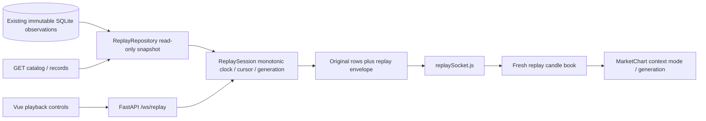

# Component responsibilities and actual data flow

```mermaid
flowchart LR
    Yahoo[Yahoo Finance WebSocket] --> Shared[One yfinance socket / four symbols]
    Shared --> Normalize[Normalize quote / per-symbol freshness]
    Normalize --> Transaction[SQLite transaction: raw + candle revision]
    Timer[Candle completion timer] --> Transaction
    Transaction --> Commit[Post-commit record hook]
    Commit --> Hub[MarketSocketHub]
    Hub --> Q1[Bounded client queue / AAPL]
    Hub --> Q2[Bounded client queue / MSFT]
    Q1 --> WS[FastAPI /ws/market]
    Q2 --> WS
    WS --> Proxy[Vite WebSocket proxy]
    Proxy --> Client[Reusable Vue WebSocket service]
    Client --> Book[Revision-aware candle book]
    History[REST saved candle history] --> Book
    Book --> Chart[Lightweight Charts: price and volume panes]
    Client --> UI[Dashboard: price / age / connection states]
    Chart --> UI
    UI -->|subscribe symbol + request_id| WS
    UI -->|GET /api/health| Health[Health route]
```

| Component | Responsibility |
| --- | --- |
| backend/app/main.py | Lifespan startup/shutdown for database, socket hub and market service |
| services/yahoo_stream.py | Pinned yfinance adapter and one upstream subscription set |
| services/normalization.py | Preserve original provider fields, UTC times and fallback observation identity |
| services/market_data.py | Shared transport/reconnects; independent per-symbol repositories and freshness |
| services/candles.py | Deterministic source-time quote OHLC and lineage; no invented volume |
| services/market_repository.py | Atomic persistence, post-commit events, snapshot and REST reads |
| services/database.py / schema.sql | Append-only transactions, revisions, duplicate detection and indexes |
| services/market_socket.py | Versioned envelope, thread-safe fanout scheduling, bounded client queues, status pulses |
| routes/market_socket.py | Origin checking, subscription validation, one sender/receiver per client, shielded cleanup |
| routes/health.py / market.py | Independent health and historical read-only market APIs |
| frontend/src/services/marketSocket.js | Same-origin WebSocket, request generations, reconnect limits and idle watchdog |
| frontend/src/App.vue | Symbol/interval selection, history/live merge, last-known information and distinct connection states |
| frontend/src/components/MarketChart.vue | Reusable candlestick/volume chart, overlays, resize/lifecycle and attribution |
| frontend/src/services/candleBook.js | Stable candle identity, revision ordering and bounded display window |
| frontend/src/services/candleHistory.js | Historical HTTP generations/abort and live merge |
| frontend/src/services/chartRenderer.js | Supported TradingView series updates and sorted historical insertion |
| frontend/vite.config.js | /api HTTP proxy and /ws upgrade proxy |
| backend/scripts/verify_market_socket.py | Explicit network pipeline verification with REST/SQLite record comparison |
| backend/tests and frontend/tests | Offline mocked transport, rollback, isolation, lifecycle and UI tests |

The browser has no Yahoo connection or credentials. Connecting/switching a browser
only changes its backend filter. The finite four-symbol Yahoo subscription is shared
and recreated once per upstream reconnect. Raw and candle rows commit before any
broadcast. Disconnected/slow clients cannot block the market service. Feed failures
continue to be sent as status while the browser socket remains open.

On resubscription the latest committed quote/candle is sent as a labeled snapshot;
this restores last-known values without pretending a new provider observation occurred.
The selected request generation prevents queued old-symbol frames from mixing stocks.

Protocol details, delivery guarantees, limits and close codes are in
[websockets.md](websockets.md). There is no trading, indicator, AI or audio
implementation, no automatic gap replay, and no multi-process message broker.

The chart receives backend-constructed OHLC, not raw prices reaggregated in Vue.
`/api/market/symbols` now includes active_interval for the initial UI selection.
HTTP history and WebSocket revisions merge into the same book; old selection
responses and lower revisions cannot replace current state. Only explicit reliable
interval volume becomes histogram bars. The current Yahoo quote feed supplies none,
so the aligned pane remains honestly empty. See charting.md for rendering details.

## Independent recorded replay flow

ReplayRepository is responsible for bounds, ordering and as-of baseline; ReplaySession
owns pure timed state; routes/replay.py validates commands and transports each client's
session. Replay does not call the Yahoo adapter, live hub, ingestion or database writes.
A backend with FEED_ENABLED=false supports replay fully from saved observations.

App.vue disposes live history and closes its market socket on entry. Callback epochs,
transport generations and symbol/interval/revision checks isolate replay. Restart/Stop
clear future chart state and reapply the original baseline. Returning to Live creates
fresh history and resubscribes; intermediate live rows remain in SQLite even while
this browser replays. Other browsers/provider capture continue independently.
A lost replay transport ends its in-memory session; explicit reload is required.
See replay.md for message schema and exact state transitions.

## Final pipeline trace and verification boundaries
The final audit's actual Yahoo observation #453 was decoded with its original payload,
normalized with separate source/receipt UTC values, committed, broadcast as a new
non-snapshot market_observation, and displayed in Vue. The independent socket capture
matches the SQLite row exactly; browser source time, receipt time and price match too.
See evidence/final-end-to-end-trace.json. ID numbers refer to that audit's isolated
fresh database, not globally unique IDs across installations.

A browser subscription snapshot is a read of a prior row. verify_market_socket.py now
keeps snapshots separate and only newly broadcast raw observations can prove current
provider receipt. It checks the exact ID using the ingest cursor rather than assuming
that the first 1,000 historical rows contain the observed event. Neither a successful
probe nor a fresh socket establishes exchange real-time entitlement.

Native volume bars were checked using a separate explicitly simulated database. The
actual Yahoo stream still cannot establish interval volume. No browser connects directly
to Yahoo; all chart rows still travel through persisted backend records and APIs/sockets.

Fresh feed status is now explicitly separate from conservative stored provenance:
`real_time_unverified` is a status-only state for fresh unconfirmed streaming observations.
Vue displays Real-time unverified and independently ages it into delayed/stale between
messages. Stored delayed provenance stays visible under its own label, and replay,
simulated data, disconnects and last-known values retain their distinct presentation.

## All supported intervals live — 2026-11-11
The per-symbol persistence transaction now produces 1m/5m/15m revisions from one raw
observation. The existing completion timer checks all three; the existing post-commit
hub broadcasts their interval-tagged rows. Subscription restoration reads a snapshot
for each interval, and the symbols/feed-status API advertises live_intervals. Vue's
selected-interval book filters other candles. No new Yahoo socket, client-side OHLC
construction, schema migration or speculative future module is needed.
